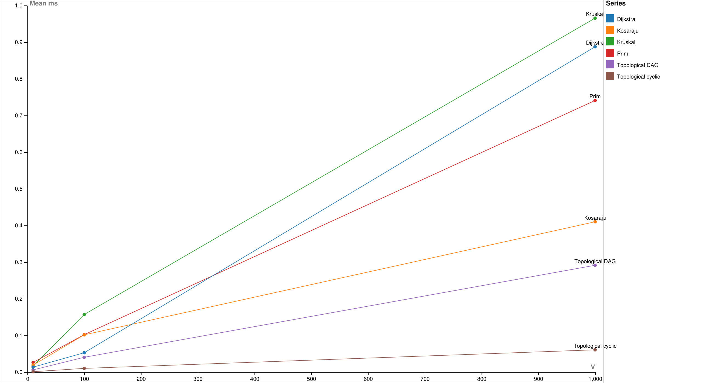

Assignment 3
Smart City Infrastructure and Route Planning
Arnur Kozhabergen
SE-2529

Overview

This is a small Java program for a city network
Vertices are districts and edges are roads or service dependencies
Weights are construction costs in the infrastructure example and travel distances in the route example
Banana depot is just one district name

The graph uses adjacency lists and a separate edge list
An undirected road is stored once in the edge list and twice in the adjacency lists
A directed road is stored once in both lists
V means the number of vertices and E means the number of logical edges

Run from the repository folder with JDK 17 or newer

```text
javac --release 17 -encoding UTF-8 -d out "@sources.txt"
java -cp out Main
java -cp out Tests
java -cp out Benchmark
```

Main prints the MST edges and costs and the service order and SCC groups
It also prints shortest distances and paths from the selected source
The default source is 0
For example this command starts at Banana depot

```text
java -cp out Main 1
```

Source numbers

```text
0 Central square
1 Banana depot
2 Hospital
3 University
4 Park
5 Old station
```

Implementation

Graph and Edge keep the road data in src/graph
DSU in src/dsu uses recursive path compression and union by size
find replaces a parent with the root
union attaches the smaller tree below the larger tree

MST in src/mst contains Kruskal and Prim
Kruskal sorts a copy of the edges and uses DSU to avoid cycles
Prim takes the cheapest candidate edge from a PriorityQueue
Both return selected edges and total weight and a connected flag
For disconnected input they return a minimum spanning forest and connected is false

Connectivity in src/connectivity uses Kahn for topological ordering and Kosaraju for SCC
Kahn removes vertices with zero indegree
If not every vertex can be removed the graph has a cycle
The returned order is empty in this case
Kosaraju records DFS finish order and then visits the reversed graph in reverse finish order
Each second pass search gives one SCC

Dijkstra in src/shortestpath keeps distances and previous vertices
It uses a PriorityQueue and skips old queue entries
pathTo follows previous vertices backwards and reverses the list
An unreachable distance is Long.MAX_VALUE and its path is empty
Distances and MST totals use long so sums can exceed the int range

Dijkstra checks all edge weights and rejects any negative weight
Its greedy argument needs non negative edges
A negative edge could make a route shorter after an earlier distance was treated as final
Bellman Ford is a suitable alternative when negative edges are allowed

Complexity Analysis

The input graph takes O(V + E) space
The space column below is additional space including returned results
PriorityQueue is a binary heap
Prim and Dijkstra allow several queue entries for one vertex so their queues can take O(E) space

| Algorithm | Time | Extra space |
|---|---|---|
| DSU find and union | O(alpha(V)) amortized per operation | O(V) for DSU storage |
| Kruskal | O(V + E log(E + 1)) | O(V + E) |
| Prim | O(V + E log(E + 1)) | O(V + E) |
| Kosaraju SCC | O(V + E) | O(V + E) |
| Topological ordering | O(V + E) | O(V) |
| Dijkstra | O(V + E log(E + 1)) | O(V + E) |

DSU initialization takes O(V)
Without compression a single find is at most O(log V) because union by size limits tree height
Compression makes later searches go directly towards the root
Together the two rules give the amortized inverse Ackermann bound
alpha(V) grows very slowly
One recursive find needs at most O(log V) stack space

Kruskal sorts E edges and then makes DSU operations
Prim and Dijkstra perform heap operations while examining roads
For simple connected graphs their usual bound is O(E log V)
The more general bounds in the table also include isolated vertices and possible parallel edges
Kosaraju scans vertices and edges in both DFS passes and while building the reverse graph
Kahn scans edges to build indegrees and then scans outgoing edges of removed vertices
More vertices need larger arrays and more edges need more scanning or heap work
Restoring one shortest path takes O(V) time and space in the longest case

Kosaraju uses recursion with a possible depth of V
The tests include a chain and a cycle of 1000 vertices
Much deeper graphs may need an explicit stack instead of recursive DFS

Experimental Setup

All generators use java.util.Random with seed 42
Graphs are generated before timing and stay unchanged between runs
All generated weights are integers from 1 to 50
Generated graphs have no self loops and no duplicate edges

| Size | V | E |
|---|---:|---:|
| Small | 10 | 30 |
| Medium | 100 | 500 |
| Large | 1000 | 5000 |

Undirected graphs start with a random tree
Each new vertex connects to one earlier vertex
Random unused roads are added until the exact edge count is reached
This makes every MST input connected
Kruskal and Prim receive the same graph

DAG edges always go from a smaller vertex number to a larger one
Cyclic directed graphs start with 0 to 1 to 2 to 0
Other unused directed edges are added randomly
This guarantees a cycle but does not guarantee that every vertex is reachable from 0
Kosaraju and Dijkstra use this cyclic graph
Topological ordering is measured on both the DAG and the cyclic graph
Dijkstra uses source 0

Each case has two discarded warmup runs and five measured runs
System.nanoTime measures each algorithm call including its local arrays and counters
Generation and output and result summaries are outside the timed interval
The MST timer also includes sorting or heap creation
The Dijkstra timer includes checking for negative edges
The mean is the sum of five elapsed times divided by five
Repeated runs must give the same answer and operation counts

edge_checks counts edges visited by the algorithm
Kruskal counts examined sorted edges and stops after selecting V minus 1 edges when connected
Prim counts adjacency entries including both directions of each undirected road
Kosaraju counts both DFS passes and the reverse graph construction so its count is 3E
Topological ordering counts indegree construction and edges scanned while removing vertices
Dijkstra counts weight validation plus outgoing edges scanned from reachable vertices
comparisons counts sort or heap comparator calls
find_calls includes recursive DSU find calls and union_calls counts attempted unions
Zero means that a counter is not used by that algorithm
The different counter columns are not one interchangeable unit of work

Saved measurements were made with Temurin Java 25.0.4.1 on Windows 11 amd64
The processor was Intel Core Ultra 9 275HX
Compilation used --release 17
An actual JDK 17 runtime was not used for these measurements

Results

Mean times below are milliseconds
The CSV keeps the mean in nanoseconds and the operation counts per measured run

| Algorithm | Graph | V | E | Mean ms |
|---|---|---:|---:|---:|
| Kruskal | undirected | 10 | 30 | 0.016300 |
| Prim | undirected | 10 | 30 | 0.026140 |
| Kosaraju | cyclic | 10 | 30 | 0.019060 |
| Topological | DAG | 10 | 30 | 0.005900 |
| Topological | cyclic | 10 | 30 | 0.000980 |
| Dijkstra | cyclic | 10 | 30 | 0.013420 |
| Kruskal | undirected | 100 | 500 | 0.156960 |
| Prim | undirected | 100 | 500 | 0.102020 |
| Kosaraju | cyclic | 100 | 500 | 0.101540 |
| Topological | DAG | 100 | 500 | 0.040280 |
| Topological | cyclic | 100 | 500 | 0.010040 |
| Dijkstra | cyclic | 100 | 500 | 0.052660 |
| Kruskal | undirected | 1000 | 5000 | 0.965460 |
| Prim | undirected | 1000 | 5000 | 0.740820 |
| Kosaraju | cyclic | 1000 | 5000 | 0.409940 |
| Topological | DAG | 1000 | 5000 | 0.291260 |
| Topological | cyclic | 1000 | 5000 | 0.060600 |
| Dijkstra | cyclic | 1000 | 5000 | 0.887340 |

| Algorithm | Graph | V | Edge checks | Comparisons | Find calls | Union calls |
|---|---|---:|---:|---:|---:|---:|
| Kruskal | undirected | 10 | 16 | 110 | 52 | 16 |
| Prim | undirected | 10 | 60 | 202 | 0 | 0 |
| Kosaraju | cyclic | 10 | 90 | 0 | 0 | 0 |
| Topological | DAG | 10 | 60 | 0 | 0 | 0 |
| Topological | cyclic | 10 | 30 | 0 | 0 | 0 |
| Dijkstra | cyclic | 10 | 60 | 32 | 0 | 0 |
| Kruskal | undirected | 100 | 191 | 3842 | 689 | 191 |
| Prim | undirected | 100 | 1000 | 7647 | 0 | 0 |
| Kosaraju | cyclic | 100 | 1500 | 0 | 0 | 0 |
| Topological | DAG | 100 | 1000 | 0 | 0 | 0 |
| Topological | cyclic | 100 | 500 | 0 | 0 | 0 |
| Dijkstra | cyclic | 100 | 1000 | 1562 | 0 | 0 |
| Kruskal | undirected | 1000 | 3992 | 46440 | 15477 | 3992 |
| Prim | undirected | 1000 | 10000 | 110094 | 0 | 0 |
| Kosaraju | cyclic | 1000 | 15000 | 0 | 0 | 0 |
| Topological | DAG | 1000 | 10000 | 0 | 0 | 0 |
| Topological | cyclic | 1000 | 5054 | 0 | 0 | 0 |
| Dijkstra | cyclic | 1000 | 9946 | 22848 | 0 | 0 |

| V | Kruskal weight | Prim weight | SCC groups | Reachable from 0 |
|---:|---:|---:|---:|---:|
| 10 | 82 | 82 | 1 | 10 |
| 100 | 604 | 604 | 2 | 100 |
| 1000 | 6660 | 6660 | 18 | 990 |




The plots were made in RAWGraphs 2.1 through the browser
Both axes use a linear scale
V and E grow together in these three configurations
The plots do not isolate the effect of changing only one of them

Run Benchmark again to replace results/tables/timings.csv and results/tables/chart-data.tsv
Exact timings depend on the machine and JVM state
The tables above are the saved report run
All graph algorithms and data export run in Java

To redraw the plots open https://app.rawgraphs.io
Paste results/tables/chart-data.tsv and choose Line chart
Map V to X Axis and Mean ms to Y Axis
Map Series to Lines and Color
Enable the legend and dots and select the Linear curve
Use E instead of V for the second plot
The SVG files in results/plots keep the original chart output

Comparison and Discussion

Kruskal and Prim agreed on the weight for every generated graph
With equal edge weights they may choose different valid trees
Kruskal was quicker on the small input in this run
Prim was quicker on the medium and large inputs
This is a measurement result and not a rule that Prim always wins
Sorting edges and maintaining a heap are different costs even when their growth bounds are similar
Prim made more comparator calls here but that alone does not determine total execution time

The DSU counters show the work used inside Kruskal
Union by size avoids a long thin parent tree
Path compression reduces repeated walks through that tree
There is no timing comparison against an unoptimized DSU in this experiment
The benefit of both rules is explained by the complexity bound

Kosaraju time grew from 0.019060 to 0.101540 to 0.409940 ms
Its edge checks grew from 90 to 1500 to 15000
The work follows V + E while the measured ratios also depend on allocation and JVM warmup

The cyclic topological case is quicker because it can stop with many vertices unprocessed
It still scans all edges when building indegrees
The large cyclic case scanned 5054 edges compared with 10000 for the DAG
Every DAG received a complete valid order and every cyclic input was rejected

Dijkstra time grew from 0.013420 to 0.052660 to 0.887340 ms
Its heap comparisons grew from 32 to 1562 to 22848
The large directed graph had 990 reachable vertices
Its edge count includes validation of all 5000 edges and scans of 4946 reachable outgoing edges
This agrees with the role of scanning and heap work in its complexity

These are small experiments with five measured runs and limited warmup
Clock overhead and JVM compilation and other running programs can affect the times
Operation counts are more reproducible than exact elapsed times
The data supports the expected growth trends but is not a proof of complexity

Testing

Run java -cp out Tests to perform the correctness checks
Tests throw AssertionError on a failed check

| Case | Checked result |
|---|---|
| Small connected graph | Both MST weights are 6 |
| Disconnected graph | Both return a forest of weight 12 and connected is false |
| Equal weights and multiple MSTs | Triangle has MST weight 4 |
| Parallel edge and self loop | Neither changes the expected MST weight |
| Single vertex | Empty MST and one SCC and zero source distance |
| DAG with an isolated vertex | Every vertex appears once and every edge follows the order |
| Directed cycles and self loop | No topological order is returned |
| Several SCCs | Groups are 0 1 2 and 3 4 and isolated 5 |
| SCC membership | Every vertex appears in exactly one component |
| Long chain and cycle | SCC handles 1000 vertices in the tested runtime |
| Known shortest routes | Distances are 0 4 3 6 6 and unreachable |
| Path restoration | Path to 4 is 0 to 2 to 1 to 3 to 4 |
| Unreachable vertex and source | Empty unreachable path and infinite distance |
| Zero weight road | Correct shortest distance |
| Large weights | Correct totals beyond Integer.MAX_VALUE |
| Negative weight | Dijkstra rejects it even in an unreachable component |
| Invalid input | Invalid vertices and wrong graph directions are rejected |
| Generated graphs | Exact sizes and fixed seed reproduction |
| Generated correctness | MST agreement and DAG validity and SCC partition and shortest path inequalities |

All 26398 checks passed in the saved run
The demo MST weight is 14 for both algorithms
The default route to Park has distance 10 and Old station is unreachable

Conclusion

Use Kruskal or Prim to connect districts with minimum total construction cost
Use SCC to find locations that can reach each other through directed roads
Use topological ordering for service dependencies only when there is no cycle
Use Dijkstra for shortest routes with non negative distances
The graph representation and queue strategy affect both time and memory

Repository

https://github.com/arnur-kozhabergen/daa.asmnt3
